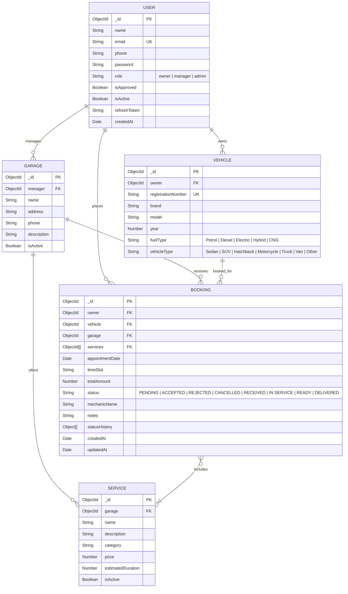

# GarageGo – Vehicle Service Booking & Management System

**Tagline:** *"Your Vehicle. Our Priority."*

GarageGo is a full-stack MERN (MongoDB, Express.js, React, Node.js) web application that connects vehicle owners with verified garages, streamlines service bookings, enforces role-based access control, delivers real-time repair status updates via Socket.IO, and generates revenue/service analytics using MongoDB Aggregation Pipelines.

---

## 1. Features

- **Authentication & RBAC:** Secure registration, login, bcrypt password hashing, JWT access & refresh tokens with automatic token rotation, logout, and role-based access control (`owner`, `manager`, `admin`).
- **Vehicle Owner Portal:** Dashboard statistics, full Vehicle CRUD, Garage & Service Catalogue discovery, multi-step service booking with double-booking prevention, booking history/cancellation, and a live visual service tracker.
- **Garage Manager Portal:** Incoming booking management (Accept/Reject), Job Card management (`RECEIVED → IN SERVICE → READY → DELIVERED`), mechanic assignment, service notes, and real-time owner notifications.
- **Admin Portal:** Platform-wide statistics, user & manager approval management, garage activation/deactivation, and full booking oversight.
- **Real-Time Communication (Socket.IO):** JWT-authenticated Socket.IO connections with private per-user rooms (`user:<userId>`), live toast alerts, notification dropdown, and automatic UI updates across browser sessions.
- **MongoDB Aggregation Reports:** Revenue by month, revenue by garage, total completed bookings, and service-wise popularity & revenue reports.

---

## 2. Technology Stack

### Backend
- Node.js & Express.js (MVC Architecture)
- MongoDB (Local) & Mongoose ODM
- `bcrypt`, `jsonwebtoken`, `dotenv`, `cors`
- Socket.IO

### Frontend
- React (Vite) & React Router DOM
- Fetch API (with automatic JWT refresh retry)
- React Context API (`AuthContext`, `SocketContext`)
- Socket.IO Client
- Plain CSS (custom automotive SaaS theme)

---

## 3. Application Screenshots

> Run the application locally and capture screenshots of the Login screen, Owner Dashboard, Live Service Tracker, Manager Job Cards, and Admin Reports for your lab submission.

---

## 4. Project Folder Structure

```text
GarageCo/
├── backend/
│   ├── config/db.js
│   ├── controllers/
│   │   ├── adminController.js
│   │   ├── authController.js
│   │   ├── bookingController.js
│   │   ├── garageController.js
│   │   ├── reportController.js
│   │   ├── serviceController.js
│   │   └── vehicleController.js
│   ├── middleware/
│   │   ├── authMiddleware.js
│   │   ├── errorMiddleware.js
│   │   └── roleMiddleware.js
│   ├── models/
│   │   ├── Booking.js
│   │   ├── Garage.js
│   │   ├── Service.js
│   │   ├── User.js
│   │   └── Vehicle.js
│   ├── routes/
│   ├── scripts/seed.js
│   ├── utils/
│   │   ├── generateTokens.js
│   │   └── socket.js
│   ├── .env.example
│   └── server.js
├── frontend/
│   ├── src/
│   │   ├── components/
│   │   ├── context/
│   │   ├── pages/
│   │   │   ├── admin/
│   │   │   ├── manager/
│   │   │   └── owner/
│   │   ├── services/api.js
│   │   ├── styles/
│   │   ├── App.jsx
│   │   └── main.jsx
│   └── package.json
├── GarageGo.postman_collection.json
└── README.md
```

---

## 5. Database Schema & ER Diagram



### Collections & Indexes
- **Users:** Stores `name`, `email` (unique index), `phone`, `password` (bcrypt hashed), `role` (indexed), `isApproved`, `isActive`, `refreshToken`.
- **Vehicles:** References `User` (`owner`, indexed), enforces unique `registrationNumber`, stores `brand`, `model`, `year`, `fuelType`, `vehicleType`.
- **Garages:** References `User` (`manager`, indexed), stores `name`, `address`, `phone`, `description`, `isActive` (indexed).
- **Services:** References `Garage` (`garage`, indexed), stores `name`, `description`, `category` (indexed), `price`, `estimatedDuration`, `isActive`.
- **Bookings:** References `User` (`owner`), `Vehicle` (`vehicle`), `Garage` (`garage`), and `[Service]` (`services`). Enforces a compound unique partial index on `{ garage: 1, appointmentDate: 1, timeSlot: 1 }` where `status` is not `REJECTED` or `CANCELLED` to prevent double-booking at the database level.

---

## 6. Authentication & RBAC

- Passwords are hashed using `bcrypt` (`genSalt(10)`) in a Mongoose `pre('save')` hook.
- Login issues a short-lived **Access Token** (`15m`) and a **Refresh Token** (`7d`) stored in MongoDB.
- `protect` middleware verifies the Bearer JWT and attaches `req.user`.
- `authorize(...roles)` middleware restricts endpoints by role and verifies `isApproved` for garage managers.
- Public registration (`/api/auth/register`) only permits `owner` and `manager` roles; `admin` registration is blocked.

---

## 7. Socket.IO Real-Time Functionality

- The client connects with `auth: { token: accessToken }`.
- Server middleware verifies the JWT and joins the socket exclusively to `user:<userId>`.
- Attempts to join another user's room are rejected.
- Events emitted: `bookingCreated`, `bookingAccepted`, `bookingRejected`, `serviceStatusUpdated`, `bookingCancelled`.

---

## 8. Aggregation Pipeline Explanation

Implemented in `backend/controllers/reportController.js`:
- **Revenue Report (`/api/reports/revenue`):** Uses `$match` (`status: 'DELIVERED'`), `$group` (by `null`, by `{ year, month }`, and by `garage`), `$lookup` (joining `garages`), `$unwind`, `$sort`, and `$project`.
- **Service Report (`/api/reports/services`):** Uses `$match` (`status: 'DELIVERED'`), `$unwind` (`$services`), `$lookup` (joining `services`), `$unwind`, `$group` (counting bookings and summing revenue per service), `$sort`, and `$project`.

---

## 9. API Endpoint Documentation

- **Auth:** `POST /api/auth/register`, `POST /api/auth/login`, `POST /api/auth/refresh`, `POST /api/auth/logout`, `GET /api/auth/me`
- **Vehicles:** `POST /api/vehicles`, `GET /api/vehicles`, `GET /api/vehicles/:id`, `PUT /api/vehicles/:id`, `DELETE /api/vehicles/:id`
- **Garages:** `GET /api/garages`, `GET /api/garages/:id`, `POST /api/garages`, `PUT /api/garages/:id`
- **Services:** `GET /api/services`, `GET /api/services/:id`, `POST /api/services`, `PUT /api/services/:id`, `DELETE /api/services/:id`
- **Bookings:** `POST /api/bookings`, `GET /api/bookings`, `GET /api/bookings/slots`, `GET /api/bookings/:id`, `PUT /api/bookings/:id/status`, `PUT /api/bookings/:id/cancel`
- **Reports:** `GET /api/reports/revenue`, `GET /api/reports/services`
- **Admin:** `GET /api/admin/users`, `PUT /api/admin/users/:id`, `GET /api/admin/garages`, `PUT /api/admin/garages/:id/approve`, `GET /api/admin/bookings`

---

## 10. Installation & Setup

### Prerequisites
- Node.js (v18+ recommended)
- Local MongoDB running on `mongodb://127.0.0.1:27017`

### 1. Backend Setup
```bash
cd backend
npm install
cp .env.example .env
npm run seed
npm run dev
```

### 2. Frontend Setup
```bash
cd frontend
npm install
cp .env.example .env
npm run dev
```

### Environment Variables

**`backend/.env`**
```env
PORT=5000
MONGO_URI=mongodb://127.0.0.1:27017/garagego
JWT_ACCESS_SECRET=your_access_secret
JWT_REFRESH_SECRET=your_refresh_secret
CLIENT_URL=http://localhost:5173
```

**`frontend/.env`**
```env
VITE_API_URL=http://localhost:5000/api
```

---

## 11. Demo Credentials

All seeded accounts use the password: **`Password@123`**

| Role | Name | Email |
|------|------|-------|
| **Admin** | System Admin | `admin@garagego.com` |
| **Garage Manager 1** | Vikram Mehta | `vikram.manager@garagego.com` |
| **Garage Manager 2** | Sneha Kulkarni | `sneha.manager@garagego.com` |
| **Vehicle Owner 1** | Rahul Sharma | `rahul.owner@garagego.com` |
| **Vehicle Owner 2** | Priya Nair | `priya.owner@garagego.com` |
| **Vehicle Owner 3** | Arjun Verma | `arjun.owner@garagego.com` |

---

## 12. Future Enhancements

- Online payment gateway integration (Razorpay/Stripe) for invoice settlement.
- Automated PDF invoice generation for `DELIVERED` job cards.
- SMS/Email reminders for upcoming scheduled appointments.
# GaregeCo
